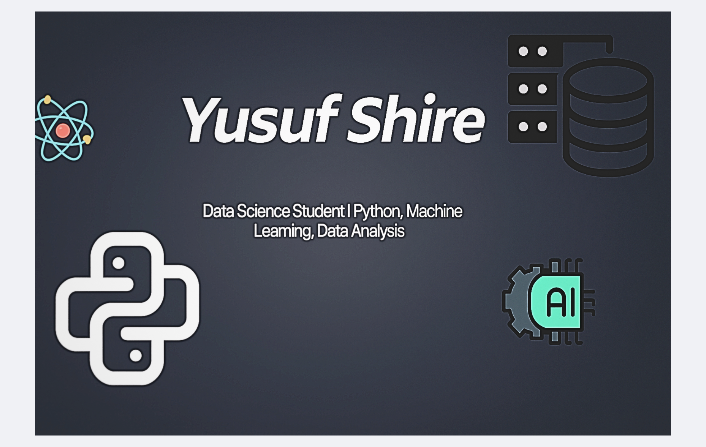

<!-- 🧠 Yusuf Shire | GitHub Profile README -->

  

<h1 align="center">Hi 👋, I'm Yusuf</h1>

<h3 align="center">
  🎓 Data Science @ UNC Charlotte | 🚛 Data Science & AI Co-op @ Daimler Truck | 🤖 Machine Learning & AI
</h3>

  
  
  
  

---

### 👨‍💻 About Me

I'm a Data Science student at the **University of North Carolina at Charlotte**, graduating in December 2027.

Currently working as a **Data Science & AI Co-op at Daimler Truck North America**, developing machine learning models, automated data pipelines, and data-driven intelligence solutions.

My interests include **Machine Learning Engineering, Deep Learning, AI Systems, and LLM Inference Optimization**, with a focus on building scalable, real-world ML applications.

### 💼 Professional Experience

**🚛 Data Science & AI Co-op | Daimler Truck North America**  
*August 2026 – Present*

- Developing Random Forest and ensemble learning models for commercial truck pricing and market intelligence.
- Engineering automated data pipelines integrating Python, web scraping, SQL Server, and Power BI.
- Building AI-ready datasets containing tens of thousands of commercial truck records for predictive analytics and VIN-level tracking.
- Developing commercial truck intelligence solutions combining ML, data warehousing, and executive dashboards.

**📊 Data Science Intern | Daimler Truck North America**  
*May 2026 – August 2026*

- Developed an unsupervised ML framework analyzing **26,000+ warranty claims across 584 dealerships**.
- Implemented Isolation Forest, LOF, DBSCAN, and One-Class SVM for anomaly detection.
- Engineered dealer-level features, consensus scoring, and automated executive reporting workflows.

---

### 🔭 Currently Working On

🚛 **Commercial Truck Pricing Intelligence** — Machine learning models for vehicle valuation, market analysis, and pricing opportunities.

⚙️ **Automated Data Engineering Pipelines** — Scalable Python and SQL Server workflows for data collection, processing, and analytics.

🧠 **PyTorch & Transformer Learning** — Building foundational deep learning components and exploring efficient model inference.

### 🌱 Currently Learning

PyTorch • Deep Learning • Transformer Architectures • LLM Inference • ML Systems • AWS • MLOps

### 👯 Collaboration Interests

Machine Learning Engineering • AI/ML Projects • Sports Analytics • Data Engineering • Predictive Modeling • LLM Applications

### 🤝 Seeking to Explore

ML Model Deployment (AWS, Streamlit, Flask) • Model Optimization • GPU Computing • Scalable AI Infrastructure

### 👨‍💻 Featured Projects

🚛 **[Warranty Dealer Anomaly Detection](https://github.com/Yusufshireds26/dealer-warranty-anomaly-detection)**  
Multi-model anomaly detection pipeline using Isolation Forest, LOF, DBSCAN, One-Class SVM, and consensus scoring across 26,000+ warranty claims.

🏀 **[NBA All-Star Predictor](https://github.com/Yusufshireds26/NBA-All-Star-Predicor)**  
Machine learning classification using Logistic Regression, Random Forest, and feature engineering.

💰 **[NBA Salary Predictor](https://github.com/Yusufshireds26/Nba-Salary-Predictor)**  
Predicting NBA player salaries using historical player statistics and regression models.

📊 **[Suicide Mortality Analysis](https://github.com/Yusufshireds26/suicide-mortality-analysis)**  
Analyzing 21 years of U.S. mortality data using Python, SQL, regression models, and statistical visualizations.

🔗 **[View All My Projects](https://github.com/Yusufshireds26?tab=repositories)**

### 📝 Articles & Blogs

🧠 [**Medium – Data Science + AI Insights**](https://medium.com/@yshire)

### 💬 Ask Me About

Python 🐍 • Pandas • NumPy • Scikit-Learn • Random Forest • Anomaly Detection • SQL • Data Pipelines • Data Visualization • Sports Analytics

### 📫 Contact Me

📧 [yshire@uncc.edu](mailto:yshire@uncc.edu)

💼 [LinkedIn](https://www.linkedin.com/in/yusuf-shire-/)

### 📄 View My Resume

📜 [**View / Download My Resume**](https://github.com/Yusufshireds26/Yusufshireds26/blob/main/Yusuf_Shire_Resume.pdf)

### ⚡ Fun Fact

I can spend hours analyzing sports stats and still lose my fantasy football matchup 😅

---

## 🧰 Languages and Tools

  

**Languages:** Python • SQL • R

**Machine Learning & AI:** Scikit-learn • PyTorch • TensorFlow • Random Forest • Anomaly Detection • Predictive Modeling

**Data Engineering & Analytics:** Pandas • NumPy • SQL Server • SQLite • Web Scraping • Power BI • Feature Engineering

**Visualization:** Matplotlib • Seaborn

**Tools & Cloud:** Git • GitHub • AWS • VS Code • Jupyter Notebook

---

## 📊 GitHub Dashboard

  
  

  

---

⭐ Inspired by curiosity, driven by data, and powered by creativity.

